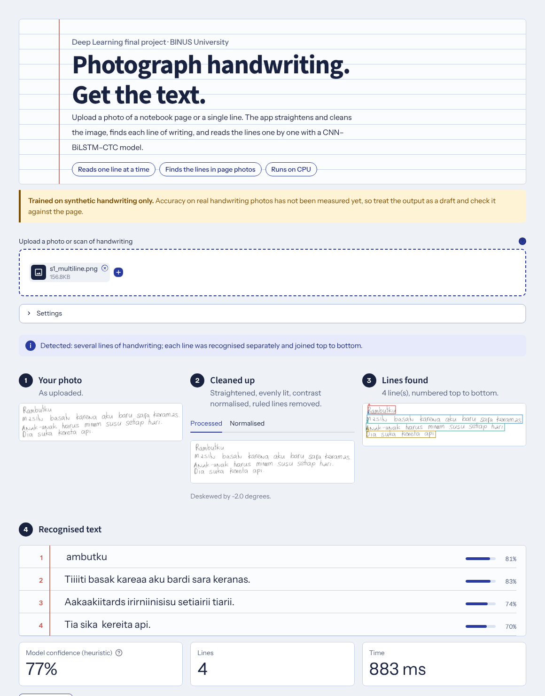

# Deep Learning-Based Recognition of Indonesian Handwritten Text Under Real-World Image Conditions

BINUS University · COMP6826001 Deep Learning · Odd Semester 2026/2027

A CNN + BiLSTM + CTC system that converts an image of Indonesian handwriting
into digital text, with a controlled investigation of where and why it fails
(long and multiline handwriting) and a working Streamlit application.

> **Honest scope.** The model is trained and tested on **synthetic** handwriting
> (OpenHand-Synth), *not* on real student notes. Results on synthetic data do not
> predict accuracy on real photos; the real-world evaluation protocol in
> [`evaluation/`](evaluation/PROTOCOL.md) exists to measure that gap.

## 1. Problem and motivation

Students take handwritten notes, but searching, sharing and editing them requires
digital text. Handwriting varies by writer, and photos add noise, blur and uneven
lighting. We ask:

> **How well can a deep learning model recognise Indonesian handwritten text when
> handwriting style, text length and layout change — and what limits it?**

The baseline error analysis showed that **long and multiline text is the dominant
weakness**, so Experiments 1–3 test three different ideas for addressing it.

## 2. Pipeline

```
image → grayscale → resize to height, pad to 128×1024 white canvas
      → CNN (4 conv blocks, width kept as the sequence axis)
      → 2-layer BiLSTM (hidden 256)
      → linear classifier (70 classes = 69 characters + CTC blank)
      → CTC greedy decoding → text
```

Baseline: 7,296,710 parameters; AdamW (lr 3e-4, weight decay 1e-4), batch size 4,
10 epochs, gradient clipping 5, CTC loss. Model code: `src/model.py`.
Preprocessing, decoding and metrics are defined once in `src/htr_common.py` and
shared by training, evaluation and the app.

### Photographs of pages (application pipeline)

The model above is a **single-line recognizer**. A photograph of a notebook page is
therefore not fed to it directly. The app first runs

```
photo → orientation / perspective / deskew → illumination + contrast normalisation
      → (optional) notebook-ruling suppression → handwriting-line detection
      → one crop per line (long lines cut at word gaps) → the unchanged model
      → lines joined top to bottom
```

A single line is recognised as such and not split; a blank or non-handwriting image gets
an explicit message instead of meaningless text. The model was **not** retrained. Details,
stages, parameters and limitations: [`DOCUMENT_PIPELINE.md`](DOCUMENT_PIPELINE.md).
Whether this improves recognition on real photographs has **not been measured yet**: run
`src/evaluate_pipeline.py` on your own photos ([`evaluation/real_world/README.md`](evaluation/real_world/README.md)).

## 2b. Training on English handwriting (IAM) - in progress, no results yet

The synthetic-only model could not read a real cursive photo (one case). Code to train
the same architecture on the IAM handwriting database (English, real writers) with
photo-style augmentation is in place and unit-tested, but **has not been run on the real
data**. This would change the project's language from Indonesian to English; see
[`IAM_TRAINING.md`](IAM_TRAINING.md) for the status, licence note, commands and what is
still unknown.

### Translation (English to Indonesian)

The app has a "Translate to Indonesian" button under the recognised text (`src/translation.py`). It
sends the text, not the photo, to Google Translate through `deep-translator`, so it needs internet and
is not tested against the live service from the development workspace. Recognition mistakes are
translated as written; the text box lets you correct them first.

## 3. Dataset

[OpenHand-Synth](https://huggingface.co/datasets/to-be/OpenHand-Synth), Indonesian
(`ind`) subset: 1,665 train / 207 validation / 209 test images (after dropping
samples that cannot be emitted within the CTC length: 1,655 train and 208 test
for the 256-step models). Metadata: writer, neatness, line width, colour, augmented noise,
text source. **Limitations:** synthetic handwriting; machine-generated text
sources (Tatoeba sentences, Faker names/dates); about half the samples carry
synthetic noise; neatness is confounded with other variables and is *not*
interpreted causally. Generate the exact statistics with
`python src/dataset_stats.py`.

## 4. Experiments

All models are evaluated on the **same 208 test samples**.
Primary metrics: **corpus CER, corpus WER, exact match**. Secondary: macro-CER
(mean of per-sample CER) for subgroup diagnostics. Never mix the two CERs.

| Model | Change from baseline | Corpus CER | Corpus WER | Exact | Macro-CER |
|---|---|---:|---:|---:|---:|
| **Baseline** | – | **68.79%** | **85.08%** | **6.25%** | **41.28%** |
| Exp 1 | width 1024→1536, 256→384 CTC steps | 71.80% | 89.37% | 4.33% | 47.18% |
| Exp 2 | height 128→192 | 81.70% | 99.07% | 0.00% | 67.84% |
| Exp 3 | 50/50 multiline-balanced sampling | 81.36% | 98.37% | 0.00% | 70.09% |

Regenerate every table and figure from the saved predictions:

```bash
python src/analyze_model.py --model all      # needs checkpoints + dataset
python src/report_assets.py                  # -> results/tables, results/figures
```

**Observations** (measured, baseline): single-line macro-CER 17.1% vs multiline
88.0%; all 49 "very long" test samples are multiline; 60/208 predictions collapse
to under 25% of the reference length. **Inference, not proven:** configurations
that change the input size or sampling stopped while validation CER was still
falling, so part of their deficit may be under-training; the optional control
`src/train_baseline_extended.py` tests this. Each configuration was trained once
(no seed variance estimate). See [`FINAL_MODEL.md`](FINAL_MODEL.md) and the report
for the full analysis.

## 5. Application

```bash
python src/export_final_model.py --model baseline   # creates models/final_model.pt
streamlit run app/app.py
```

Upload a photo (one line or a notebook page) and the app runs on its own. The page reads
top to bottom like the pipeline: **1 your photo → 2 cleaned up** (processed / normalised
tabs) **→ 3 lines found** (numbered boxes) **→ 4 recognised text**, shown on ruled paper with
one row per detected line and its heuristic confidence (labelled as such; not a calibrated
probability). Below: download or copy the text, a **"What the model sees"** expander with the
exact crops fed to the model, and an optional evaluation form. *Settings* offers the
pipeline (A original, B improved preprocessing, C + line detection, **D + ruling suppression =
default**), a manual page rotation, and "Recognize anyway" for images judged blank. An
"About this model" section states the measured synthetic-test numbers and that the model was
trained on synthetic data. Theme: `app/style.css`, `app/ui_components.py`,
`.streamlit/config.toml`.



Recommended input: a flat, evenly lit photo taken from above, the page filling most of
the frame, dark ink on light paper, handwriting at least ~25 px tall. See
[`DOCUMENT_PIPELINE.md`](DOCUMENT_PIPELINE.md) for limitations.

To put it on a website (Streamlit Community Cloud, Hugging Face Spaces or Docker), see [`DEPLOY.md`](DEPLOY.md).

## 6. Real-world evaluation

[`evaluation/PROTOCOL.md`](evaluation/PROTOCOL.md): (A) a photo test set written by
real people under real capture conditions, scored with
`python src/evaluate_realworld.py`; for photographed PAGES, `python src/evaluate_pipeline.py`
compares pipelines A-D (+ hand-cropped lines, E) on photos you put in
`evaluation/real_world/` ([README](evaluation/real_world/README.md)); (B) a usability session with the SUS
questionnaire, scored with `python src/summarize_usability.py`.
**Results appear in the report only once collected.**

## 7. Reproducing

```bash
pip install -r requirements.txt
python -m pytest tests -q                  # 99 tests, no dataset/GPU needed
python src/train.py                        # baseline  -> checkpoints/baseline_best.pt
python src/train_experiment1.py
python src/train_experiment2.py
python src/train_experiment3.py
python src/analyze_model.py --model all
python src/report_assets.py
python src/record_environment.py           # versions + checkpoint hashes
```

Run everything from the repository root. Hardware used: RTX 3060 Ti (8 GB), Ubuntu.
Seeds: Experiment 3 uses seed 42; `train.py` now sets seed 42 too, but the reported
baseline was trained before that was added (checkpoint hash recorded in
`results/analysis/baseline_analysis.json`). Checkpoints are git-ignored.

## 8. Repository layout

```
src/htr_common.py          shared preprocessing / decoding / metrics / model loading
src/dataset.py, dataloader.py, model.py, model_experiment2.py
src/train*.py              baseline + Experiments 1-3 (+ optional extended control)
src/analyze_model.py       unified evaluation + error analysis for any model
src/report_assets.py       report tables and figures from real outputs
src/export_final_model.py  slim deployment checkpoint with provenance
src/evaluate_realworld.py, summarize_usability.py
src/document_pipeline.py   photo preprocessing, ruling suppression, line detection, crops
src/page_recognition.py    pipelines A-D: photo -> lines -> existing model -> text
src/evaluate_pipeline.py   real-photo evaluation of A-D (+E): CER/WER only with ground truth
src/evaluate_segmentation.py, synthetic_pages.py   synthetic geometry benchmark (not real handwriting)
app/                       Streamlit app (app.py, app_logic.py, evaluation_log.py)
evaluation/                real-world protocol, prompts, questionnaire, templates
evaluation/real_world/     put page photographs here for evaluate_pipeline.py
DOCUMENT_PIPELINE.md       photo pipeline: stages, fallbacks, limitations
experiments/               per-experiment write-ups
results/                   histories, predictions, tables, figures
report/                    report skeleton, evidence map, AI usage log
tests/                     pytest suite
```

Legacy per-experiment scripts (`error_analysis*.py`, `evaluate*.py`,
`compare_*.py`) are kept for traceability; `analyze_model.py` reproduces their
numbers (verified by tests on the committed predictions).

## 9. Current limitations

Synthetic training data; the model reads ONE line at a time (long and multiline text
mostly fail when fed directly); single training run per configuration; models trained for
10 epochs only; greedy decoding without a language model. The app now detects and crops
lines in photographs with heuristic (non-learned) code, but **performance on real photos
is not yet measured**, so no improvement is claimed; synthetic-page checks of that code
are optimistic. Known weaknesses of the photo pipeline (ruling suppression removes
underlines/strike-throughs, columns and curved pages unsupported, orientation by
heuristic): see [`DOCUMENT_PIPELINE.md`](DOCUMENT_PIPELINE.md).
